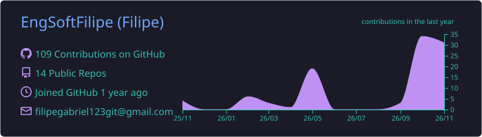
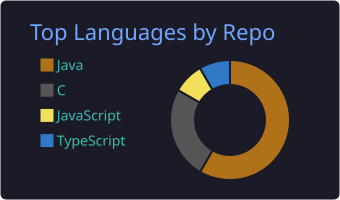
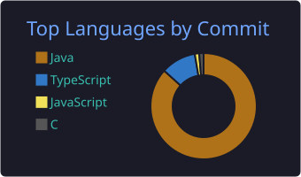
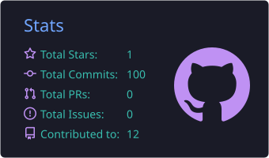
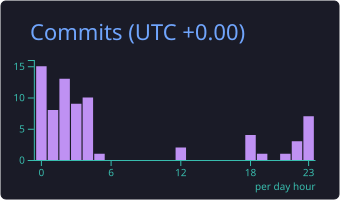

<h1 align="center" translate="no">Olá! Seja bem-vindo ao Github de um futuro engenheiro de software </h1>
 
###
 
<h2 align="left" translate="no"> Até o momento</h2>
 

  
  
  
  
  
  
  
  
  
  
  
  
  
  
  
  
  
  
  
  
  

 
<!-- Linha separadora -->

<h2 align="left" translate="no"> Em breve</h2>

  
  
  
  
  
  
  
  
  
  
  

 

<h2 align="left" translate="no"> Estatísticas</h2>

  <!-- Linha 1: resumo do perfil -->
  
   
  <!-- Linha 2: linguagens -->
  
  
   
  <!-- Linha 3: números e horário -->
  
  
   
   
  <!-- Linha 4: sequência -->
  

 

<h2 align="left" translate="no"> Contato</h2>

  

